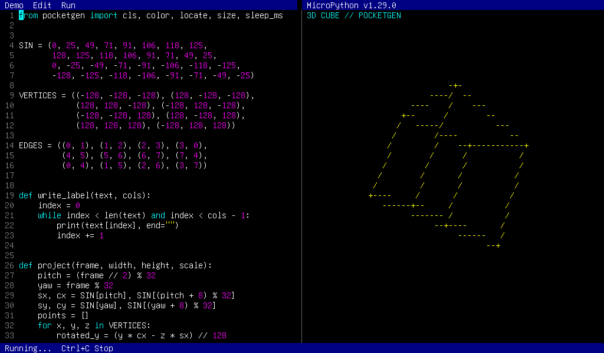
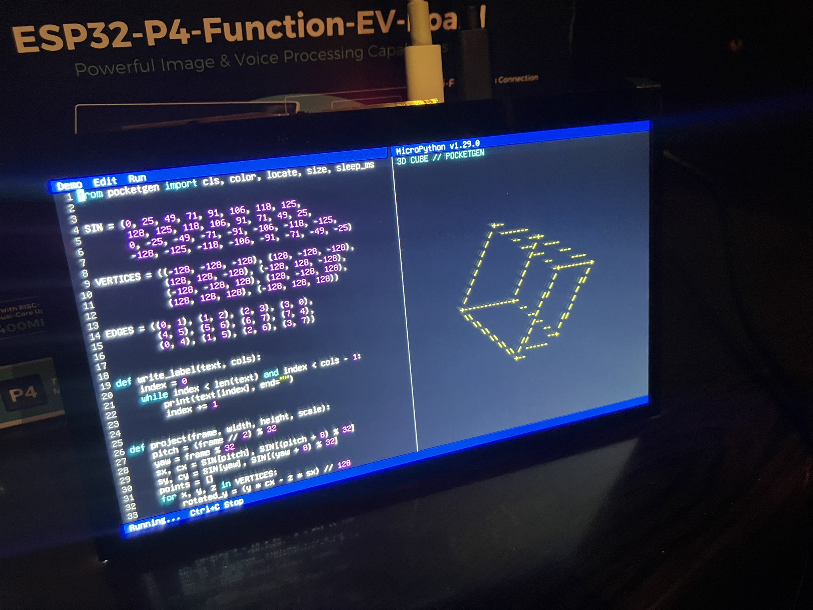
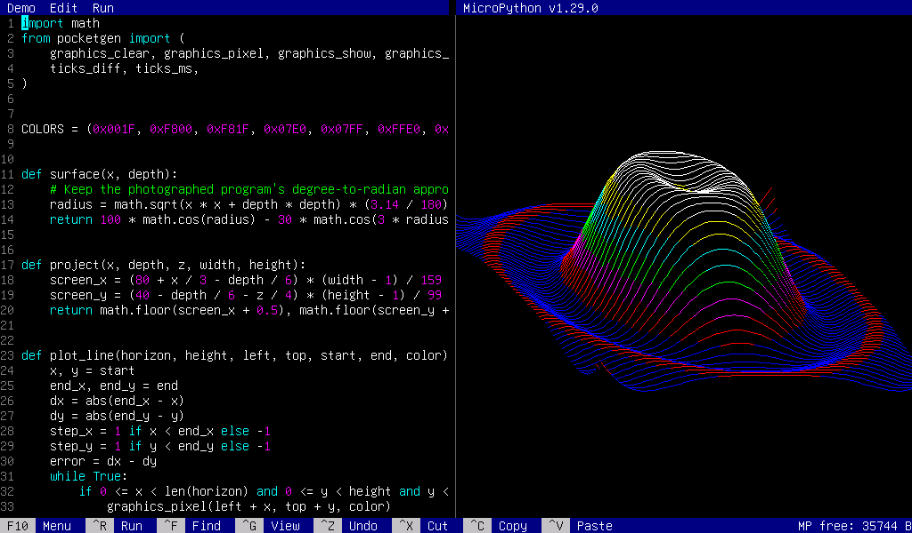
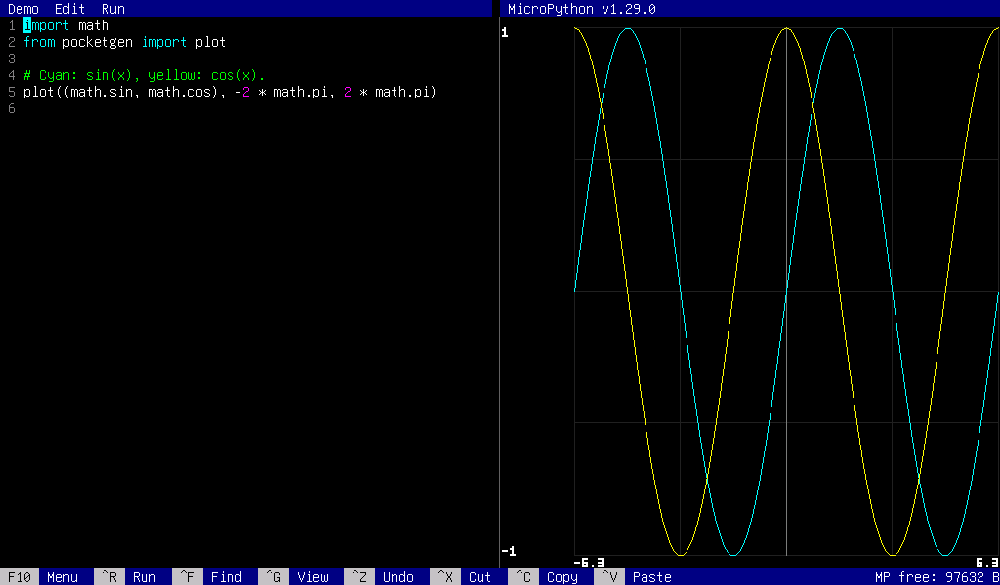
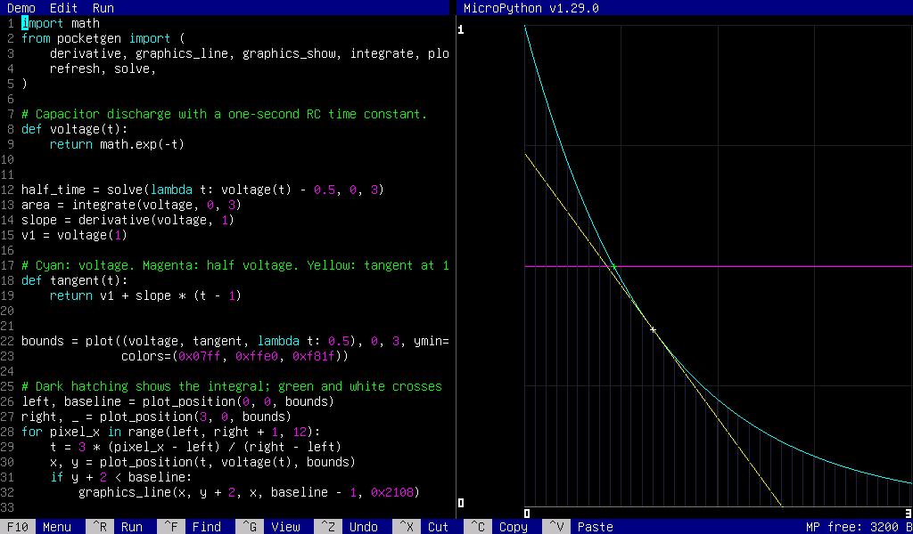
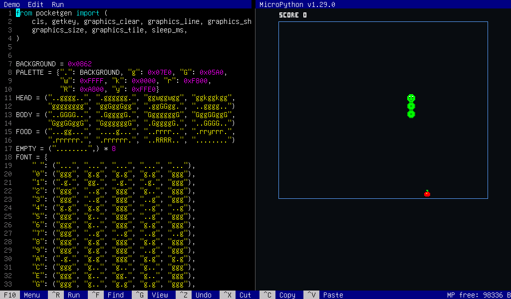
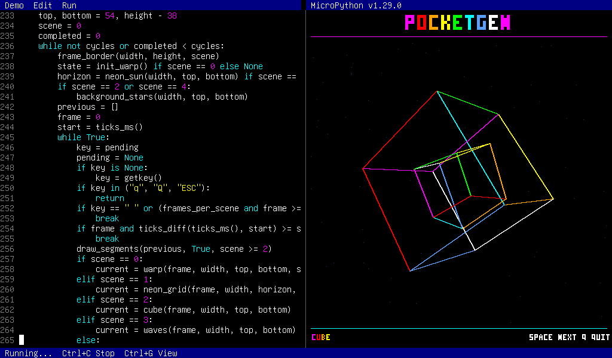

# pocketgen

pocketgen is a pocket computer application for Zephyr RTOS.

It combines an editor derived from Microsoft Edit with MicroPython: edit Python source in the
left pane and run it in the right pane.

It currently supports native simulation and the ESP32-P4 Function EV Board.
Adding board support could enable it to run on a variety of other
Zephyr-compatible platforms.



## Zephyr setup

These steps use Ubuntu 26.04 on x86-64. The project root is a west workspace;
Zephyr is a Git submodule pinned to the tested commit
[`072fd9442fe12568bcc3d3c61e4f390ed5cf35a3`](https://github.com/zephyrproject-rtos/zephyr/commit/072fd9442fe12568bcc3d3c61e4f390ed5cf35a3)
(`4.5.99`, a development revision without a release tag).

Install the system dependencies and [Rust with rustup](https://rustup.rs/):

```sh
sudo apt update
sudo apt install -y ca-certificates ccache cmake device-tree-compiler dfu-util \
    file g++-multilib gcc-multilib git gperf libclang-dev libmagic1 libsdl2-dev \
    make ninja-build python3-dev python3-pip python3-tk python3-venv screen wget xz-utils
```

Clone pocketgen:

```sh
git clone https://github.com/h1romas4/pocketgen.git
cd pocketgen
```

Initialize the required submodules and the project-local west workspace, then
install the required Python packages and Rust targets. The downloads may take
some time.

```sh
git submodule update --init
git -C components/micropython submodule update --init lib/micropython-lib
export ZEPHYR_BASE="$PWD/zephyr"
python3 -m venv .venv
source .venv/bin/activate
pip install --upgrade pip west
west init -l zephyr
west config manifest.project-filter +zephyr-lang-rust
west update --narrow --fetch-opt=--depth=1 zephyr-lang-rust hal_espressif
pip install -r zephyr/scripts/requirements-base.txt \
    -r modules/hal/espressif/zephyr/requirements.txt
rustup target add x86_64-unknown-none riscv32imafc-unknown-none-elf
west sdk install --gnu-toolchains riscv64-zephyr-elf
```

`west sdk install` reuses a compatible installed SDK when available. Run
`west sdk list` to see its location and installed toolchains.

In each new shell, from the project root:

```sh
source .venv/bin/activate
export ZEPHYR_BASE="$PWD/zephyr"
```


GitHub Actions builds native-sim and ESP32-P4 and runs the native integration
and component tests on Ubuntu 26.04.

## Native-sim build

Build and launch from the repository root:

```sh
west build -b native_sim/native/64 . -d build/workspace/native_display
python3 scripts/native-sim.py
```

The launcher connects its terminal to the virtual UART automatically.
Alternatively, run the simulator directly:

```sh
build/workspace/native_display/zephyr/zephyr.exe
```

In another terminal, connect `screen` to the `/dev/pts/N` device printed by
the simulator:

```sh
screen -U /dev/pts/N 115200
```

The SDL window is for display only. Keep the launcher terminal or the `screen`
terminal focused to enter keys; the SDL window does not receive input.
To close `screen`, press **Ctrl+A**, then **K**, then **Y**; stop the simulator
separately in its terminal.

## ESP32-P4 build



The configuration targets the ESP32-P4 Function EV Board with a 1024x600
EK79007 DSI LCD and PSRAM. It requires the FPU and the Rust
`riscv32imafc-unknown-none-elf` target. With both the board and LCD power
disconnected, connect the LCD adapter:

| LCD adapter | ESP32-P4 Function EV Board |
| --- | --- |
| J3 | MIPI DSI connector |
| J6 `RST_LCD` | J1 GPIO27 |
| J6 `PWM` | J1 GPIO26 |

Use a reverse-direction LCD ribbon cable, with contacts on opposite sides at
its ends. When powering the LCD adapter through its J1 USB connector, do not
also connect its 5V and GND pins to the board. See Espressif's
[hardware setup guide](https://docs.espressif.com/projects/esp-dev-kits/en/latest/esp32p4/esp32-p4-function-ev-board/user_guide_v1.4.html#hardware-setup).

Connect the board's USB-UART port and build and flash from the repository root:

```sh
west build -b esp32p4_function_ev_board/esp32p4/hpcore . -d build/workspace/esp32p4_pocketgen
west flash -d build/workspace/esp32p4_pocketgen --esp-device /dev/ttyUSB0
```

Replace `/dev/ttyUSB0` with the board's serial device. After flashing, connect
to UART0 at 115200 baud:

```sh
screen /dev/ttyUSB0 115200
```

Type in this terminal while watching the LCD. To exit `screen` and release the
serial port, press **Ctrl+A**, then **K**, then **Y**. **Ctrl+A**, then **D**
only detaches and leaves the port in use.

The board configuration starts the Mega Demo automatically. In the
[board configuration](boards/esp32p4_function_ev_board_esp32p4_hpcore.conf),
replace `CONFIG_POCKETGEN_AUTOSTART_MEGA=y` with
`CONFIG_POCKETGEN_AUTOSTART_NONE=y` to start with the maze loaded instead, or
`CONFIG_POCKETGEN_AUTOSTART_CUBE=y` for the 3D Cube demo.

ESP32-P4 revision v0.1 has been tested but is experimental: the board
definition targets v1.3, and revision and ROM SHA-256 warnings appear at boot.

## VS Code

- **Terminal:** New integrated terminals on Linux set `ZEPHYR_BASE` to the
  project-local Zephyr and add `.venv/bin` to `PATH`. Shell startup files can
  override these settings; if they do, run the exports in
  [Zephyr setup](#zephyr-setup) after the shell starts. Restart existing
  terminals after changing VS Code settings.
- **Tasks:** Use **Tasks: Run Build Task** for **Build native-sim** or
  **Build ESP32-P4**. **Tasks: Run Task** also offers **Flash ESP32-P4**, which
  prompts for the serial device. Tasks require `west` on `PATH` and the Zephyr
  environment variables in their terminal environment.
- **rust-analyzer:** Diagnostics use the native-sim Cargo configuration.
  Build native-sim once before opening or reloading the project to generate it.

## Controls

| Key | Action |
| --- | --- |
| **F10** | Open the menu; select a demo, edit command, or Run. |
| **Ctrl+R** | Run the editor buffer. |
| **Ctrl+C** | Copy the selection, or interrupt a running script. |
| **Ctrl+G** | Toggle the text and graphics output views. |
| **Ctrl+F** | Open search. |
| **Ctrl+Z / X / V** | Undo / cut / paste. |
| **Ctrl+A** | Select all. |
| **Home / End**, **Ctrl+Home / End** | Move to the start/end of the line or document. |
| **Page Up / Down** | Move one page toward the start/end of the document. |
| **Shift** + navigation | Extend the selection. |
| **Ctrl+]** | Exit the native-sim launcher. |

Search is case-sensitive and wraps around the document. In the search prompt,
**Enter** or **Ctrl+N** selects the next match, **Ctrl+P** the previous one,
**Backspace** edits the query, and **Esc** closes the prompt. A single-line
selection of up to 256 UTF-8 bytes pre-fills the query; the first search moves
to the next or previous match. Queries are limited to 256 UTF-8 bytes.

`screen` reserves **Ctrl+A**: press **Ctrl+A**, release it, then press **A**
to send it to the editor. It may delay a standalone **Esc** while distinguishing
it from terminal key sequences.

The text and graphics buffers are retained during a run. Printing selects text
and drawing selects graphics automatically; **Ctrl+G** selects a view manually
until the next run. Exceptions select text even in manual mode. Without a
graphics buffer, **Ctrl+G** leaves text visible. Starting another run clears
the text output and releases the previous graphics buffer.

## Demos

Select a demo from the **F10 → Demo** menu, then press **Ctrl+R** to run it.
Loading replaces the editor buffer; **Ctrl+Z** undoes the replacement.

| Demo | Output | Description |
| --- | --- | --- |
| [Maze](examples/terminal_demo.py) | Text | Generates and solves mazes. |
| [Starfield](examples/starfield.py) | Text | Animates a starfield. |
| [3D Cube](examples/cube.py) | Text | Animates a rotating cube. |
| [Mexican Hat](examples/mexican_hat.py) | Text | Draws a Mexican hat surface. |
| [Sine Graph](examples/sine_graph.py) | Graphics | Draws a sine curve. |
| [Hat (Graphics)](examples/mexican_hat_graphics.py) | Graphics | Draws and times a Mexican hat surface. |
| [Plot Trig](examples/plot_trig.py) | Graphics | Compares sine and cosine. |
| [Plot Projectile](examples/plot_projectile.py) | Graphics | Compares projectile heights at two launch angles. |
| [Plot Growth](examples/plot_growth.py) | Graphics | Compares compound growth at three interest rates. |
| [Chart Scatter](examples/chart_scatter.py) | Graphics | Fits speed to measured distance and time. |
| [Chart Histogram](examples/chart_histogram.py) | Graphics | Groups daily temperatures into bins. |
| [Chart Bar](examples/chart_bar.py) | Graphics | Compares monthly balance changes. |
| [Chart Pie](examples/chart_pie.py) | Graphics | Shows spending by category. |
| [Numeric RC](examples/numeric_rc.py) | Graphics + text | Visualizes a discharge, half-voltage time, integral, and tangent. |
| [Snake](examples/snake.py) | Graphics | Collect food with arrow keys or WASD; quit with Q or Esc. |
| [Mega Demo](examples/mega_demo.py) | Graphics | Cycles through five animated scenes; Space skips, Q or Esc quits. |

**Hat (Graphics)** prints elapsed wall-clock time in the text view; use
**Ctrl+G** to see it. The measurement includes buffer initialization, the final
`refresh()` call, intermediate display updates, and the VM's periodic 1 ms
scheduling waits, but not final physical scanout.

**Mega Demo** loops through five scenes, changing roughly every eight seconds.
Space skips a scene; Q or Esc exits. It requires a graphics area of at least
240 × 220 pixels.

### Native-sim screenshots

**Hat (Graphics)**



**Plot Trig**



**Numeric RC**



**Snake**



**Mega Demo**



## MicroPython reference

MicroPython supports double-precision floats and the `math` module. Import
the following functions from `pocketgen`:

| Function | Description |
| --- | --- |
| `cls()` | Clear the text output and move the cursor to the top-left. |
| `size()` | Return text output dimensions `(columns, rows)`. |
| `locate(x, y)` | Move the text cursor to a zero-based column and row. |
| `color(fg, bg=0)` | Set text foreground and background colors, each `0`–`15`. |
| `graphics_size()` | Return graphics dimensions `(width, height)` in pixels. |
| `graphics_clear(color=0)` | Allocate or clear the graphics buffer and show it. |
| `graphics_pixel(x, y, color)` | Draw one pixel. |
| `graphics_line(x0, y0, x1, y1, color)` | Draw a line including both endpoints. |
| `graphics_tile(x, y, rows, palette, scale=1)` | Draw a tile defined by strings and a color palette. |
| `graphics_show()` | Show the retained graphics in automatic mode. |
| `refresh()` | Present pending changes during a running script. |
| `getkey()` | Return the next key as a string, or `None` without waiting. |
| `sleep_ms(ms)` | Wait for non-negative milliseconds while processing events. |
| `ticks_ms()` | Return a monotonic millisecond counter. |
| `ticks_diff(end, start)` | Return the wrap-safe difference between two ticks. |
| `plot(functions, xmin=-10, xmax=10, ymin=None, ymax=None, colors=None, grid=True)` | Plot one or more functions; see below. |
| `plot_position(x, y, bounds)` | Convert a point within plot bounds to graphics pixels. |
| `linear_fit(x, y)` | Return the least-squares line and coefficient of determination. |
| `scatter(x, y, fit=None, xmin=None, xmax=None, ymin=None, ymax=None, color=0x07ff, fit_color=0xffe0, grid=True)` | Plot points and an optional fitted curve. |
| `hist(data, bins=10, xmin=None, xmax=None, color=0x07ff, grid=True)` | Draw a histogram and return counts and edges. |
| `bar(values, labels=None, ymin=None, ymax=None, color=0x07ff, grid=True)` | Draw positive and negative bars. |
| `pie(values, labels=None, colors=None)` | Draw a pie chart and legend. |
| `solve(func, a, b, tol=1e-8, max_iter=100)` | Find a bracketed root by bisection. |
| `integrate(func, a, b, steps=100)` | Approximate a definite integral using Simpson's rule. |
| `derivative(func, x, h=1e-5)` | Approximate a derivative using a central difference. |

Text and graphics coordinates start at the top-left and must be in bounds.
Graphics colors are RGB565 integers from `0` to `65535`; call
`graphics_clear()` before drawing. Invalid coordinates or colors raise
`ValueError`; unavailable graphics or allocation failures raise `OSError`.
The retained graphics buffer uses two bytes per pixel, separately from the
128 KiB MicroPython heap; ESP32-P4 uses external PSRAM.

`ticks_ms()` wraps every 2^30 milliseconds; `ticks_diff()` is unambiguous for
intervals shorter than 2^29 milliseconds. The standard `time` module is not
enabled.

### Map tiles

```python
from pocketgen import graphics_clear, graphics_tile, refresh

apple = (".gg.", "rrrr", "rrrr", ".rr.")
palette = {".": None, "g": 0x07e0, "r": 0xf800}
graphics_clear()
graphics_tile(20, 20, apple, palette, scale=4)
refresh()
```

`rows` is a non-empty list or tuple of equally sized, non-empty strings.
Each character must have a palette entry: an RGB565 integer or `None` for
transparency. `scale` is a positive integer; the entire scaled tile must fit
the graphics area. Invalid tiles, colors, or bounds raise `ValueError`.
Call `graphics_clear()` first and `refresh()` to present during execution.
Tiles do not automatically refresh or clear the background; map a character
to a background color to erase or overwrite previous drawings.

### Keyboard input

```python
from pocketgen import getkey, sleep_ms

while True:
    key = getkey()
    if key == "q":
        break
    if key is not None:
        print(key)
    sleep_ms(20)
```

`getkey()` returns a Unicode character or `UP`, `DOWN`, `LEFT`, `RIGHT`,
`ENTER`, `ESC`, `TAB`, `BACKSPACE`, `DELETE`, `HOME`, `END`, `PAGEUP`, or
`PAGEDOWN`. Unsupported keys and invalid sequences are ignored with a warning.
Input collection starts with the first call; earlier input consumed during
execution is ignored. The 64-key queue is cleared between runs; if it fills,
new keys are dropped and the next call raises `OSError(ENOBUFS)`. Ctrl+C and
Ctrl+G remain reserved for interruption and view switching. A standalone Esc
is recognized after a 50 ms pause; incomplete sequences time out after 500 ms.

### Function plots

```python
import math
from pocketgen import plot

plot((math.sin, math.cos), -2 * math.pi, 2 * math.pi)
plot(lambda x: x * x, -5, 5, ymin=0, ymax=25, colors=0x07ff)
```

`functions` is a callable `f(x)` or a list/tuple of callables. The x range
must be finite and increasing. The y range is automatic unless both `ymin` and
`ymax` are supplied; constant ranges are expanded. Each call clears graphics
and returns `(xmin, xmax, ymin, ymax)`.

Pass these bounds to `plot_position(x, y, bounds)` to convert an in-range point
to pixels for annotations. Non-finite or out-of-range points raise `ValueError`.
Axis endpoints use two significant digits; `grid=False` hides the grid. Colors
are RGB565: use one integer or one per function. Defaults cycle through cyan,
yellow, magenta, green, orange, and white.

Functions are sampled once per horizontal pixel. `None`, non-finite results,
and `ValueError`, `ZeroDivisionError`, or `OverflowError` produce gaps; other
exceptions propagate. All undefined samples raise `ValueError`. Curves are
clipped, and segments spanning both y boundaries are omitted to reduce false
lines. Sampling may miss discontinuities or narrow features; many functions may
exceed the MicroPython heap.

### Data charts

```python
from pocketgen import linear_fit, scatter, hist, bar, pie

x, y = [0, 1, 2, 3], [0.2, 1.8, 4.1, 6.2]
slope, intercept, r2 = linear_fit(x, y)
scatter(x, y, fit=lambda t: slope * t + intercept)
counts, edges = hist([18, 19, 20, 20, 21, 22], bins=4)
bar([12, -5, 18], labels=["Jan", "Feb", "Mar"])
fractions = pie([40, 35, 25], labels=["Rent", "Food", "Other"])
```

Inputs are non-empty, indexable sequences of finite numbers, such as lists,
tuples, or arrays.

- `linear_fit`: Requires equal lengths, at least two points, and varying x.
  Returns `(slope, intercept, r2)`; `r2` is `None` for constant y.
- `scatter`: Requires equal lengths and returns `(xmin, xmax, ymin, ymax)`.
  An optional callable `fit(x)` is sampled and clipped like `plot`; automatic
  y limits include the curve.
- `hist`: Uses positive integer `bins` and returns `(counts, edges)`. Bins are
  left-inclusive and right-exclusive, except the final bin includes both ends.
  Data outside an explicit range raises `ValueError`.
- `bar`: Returns `(ymin, ymax)`; the range must include zero. Values outside
  the range are clipped.
- `pie`: Requires non-negative values with a positive total and returns
  fractions in input order.

Ranges are automatic unless both endpoints are supplied; constant ranges are
expanded. Labels default to `1`, `2`, etc. Supplied labels must match the value
count and fit the display; they are uppercased and support ASCII letters,
digits, spaces, and `- + . / % _ :`, but not Japanese. Colors are RGB565;
pie uses the `plot` palette by default or one supplied color per value.
Each chart clears and refreshes graphics. Printing selects text in automatic
mode; use `graphics_show()` or **Ctrl+G** to return to the chart.

### Numerical calculations

```python
import math
from pocketgen import solve, integrate, derivative

root = solve(lambda x: x * x - 2, 0, 2)
area = integrate(math.sin, 0, math.pi)
slope = derivative(math.sin, 0)
```

All inputs and sampled values must be finite. Results are approximate floats;
exceptions from the callable propagate.

- `solve`: Bisection requires `a < b` and opposite endpoint signs, unless an
  endpoint is zero. It returns an exact sampled zero or the midpoint of a
  bracket no wider than positive `tol`. Invalid brackets, precision limits, or
  exceeding `max_iter` raise `ValueError`. Discontinuities can give false roots.
- `integrate`: Simpson's rule uses an even `steps >= 2` and `steps + 1` samples.
  Reversed bounds reverse the sign; equal bounds return zero without sampling.
- `derivative`: Central difference samples at `x-h` and `x+h`; `h` must be
  positive and both points representable.

Integration and differentiation do not estimate error. Compare different
`steps` or `h`, especially near discontinuities or sharp features.

The **Numeric RC** demo visualizes the discharge, half-voltage point, integral,
and tangent. Use **Ctrl+G** to see the numerical results and color legend.

## License

pocketgen is [MIT licensed](LICENSE).

Third-party components retain their own licenses:

- [Microsoft Edit-derived editor](components/pocketgen-editor/THIRD_PARTY_NOTICES.md)
- [embedded-graphics-terminal-derived terminal](components/pocketgen-terminal/THIRD_PARTY_NOTICES.md)
- [MicroPython](components/micropython/LICENSE)
